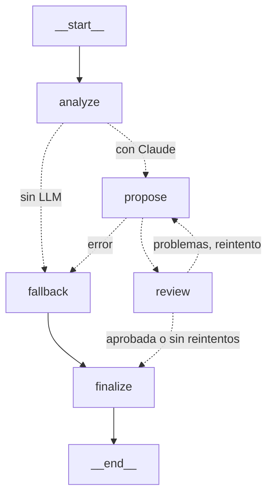

# Nemesis Protocol

**Un shooter de arena donde los enemigos aprenden de ti.** Después de cada oleada, un *AI Director*
construido con LangGraph y Claude analiza cómo juegas (qué arma usas, tu precisión, cuánto daño recibes) y hace
evolucionar a los enemigos para contrarrestar tu estilo. Si dependes de la pistola, vuelven blindados.
Si peleas con la espada, aprenden a dispararte desde lejos.

## Cómo funciona

```
 Juego (Ursina)                    AI Director (LangGraph + Claude)            Juego
┌──────────────────┐ WaveTelemetry ┌──────────────────────────────┐ Adaptation ┌────────────────────────┐
│ Oleada N         │ ────────────► │ analizar → proponer → revisar │ ─────────► │ apply_adaptation(      │
│ ataques, aciertos│               │      ▲              │         │            │   BASE_STATS, ...)     │
│ bajas por arma,  │               │      └─ corregir ◄──┘         │            │ + límites (clamps)     │
│ daño recibido    │               │ si falla: reglas locales      │            │ → la oleada N+1 evoluciona│
└──────────────────┘               └──────────────────────────────┘            └────────────────────────┘
```

1. **Telemetría.** Cada arma reporta ataques, aciertos y bajas. Al terminar la oleada se arma un
   `WaveTelemetry` con precisión, tiempo por baja, porcentaje de uso por arma y arma dominante.
2. **Decisión con LangGraph.** El Director es un grafo de estados. Claude propone la evolución con
   salida estructurada a través de LangChain, y un revisor determinista la valida antes de aceptarla.
   Corre en un hilo aparte: el juego nunca se congela y muestra *"El Director está analizando tu
   estilo de juego..."* mientras espera.
3. **Revisión y autocorrección.** Si la propuesta tiene un valor fuera de rango o no contrarresta el
   arma dominante, el revisor le devuelve a Claude los problemas concretos y le pide una versión
   corregida. Por ejemplo, en una prueba real Claude propuso `armor +5` en un stat que va de 0 a 0.5.
4. **Seguridad.** La respuesta del modelo nunca toca los stats directamente. Se convierte en una
   `Adaptation` validada y se aplica siempre sobre los stats base (no se acumula), con límites duros
   por stat.
5. **Respaldo.** Sin API key, sin red o ante cualquier error, unas reglas deterministas eligen la
   contra-evolución. El juego siempre es jugable.
6. **Se ve en pantalla.** Los enemigos cambian de color según su resistencia, ganan placas de blindaje,
   un cañón cuando atacan a distancia y franjas brillantes cuando son rápidos. Un panel explica la
   evolución, lista cada stat que cambió e indica si el revisor pidió una corrección.

### El grafo del Director



| Nodo | Qué hace |
|---|---|
| `analyze` | Construye el perfil del jugador (especialista o generalista, rendimiento) y la sugerencia de las reglas. |
| `propose` | Claude, vía `ChatAnthropic.with_structured_output`, diseña la evolución con la telemetría, el perfil, el historial y la sugerencia. |
| `review` | Valida límites, número de cambios y que la evolución ataque el arma dominante. Si falla, vuelve a `propose` con los problemas. |
| `fallback` | Usa la sugerencia de las reglas cuando Claude no está disponible o falla. |
| `finalize` | Aplica la adaptación sobre los stats base con los límites. |

Con LangSmith configurado en `.env`, cada decisión queda trazada como una corrida
`director-wave-N`, con la telemetría, el prompt, la respuesta de Claude y la revisión.

## Contra-evoluciones de ejemplo

| Si dominas con... | Los enemigos... |
|---|---|
| Espada (cortes, cuerpo a cuerpo) | resisten cortes y te disparan antes de que llegues |
| Martillo (lento y pesado) | resisten impactos, son más rápidos y atacan más seguido |
| Pistola (distancia media) | ganan blindaje y resistencia a perforación, y cierran distancia |
| Escopeta (corto alcance) | mantienen la distancia y te atacan desde fuera de su alcance |
| Arco (larga distancia) | se vuelven pequeños, muy rápidos y te detectan desde lejos |

Además, la vida de los enemigos escala con cada oleada, y pegan más fuerte si terminaste casi intacto.

## Ejecutar

Requiere Python 3.12 y [uv](https://docs.astral.sh/uv/).

```
uv sync
uv run main.py
```

Para usar Claude como Director, copia `.env.example` a `.env` y pon tu `ANTHROPIC_API_KEY`.
Sin clave, el juego usa las reglas locales. El panel superior izquierdo indica qué Director está activo.
Para trazar las decisiones en LangSmith, completa también las variables `LANGSMITH_*`.

### Idioma

El juego está en español e inglés. La variable `LANGUAGE` del `.env` define el idioma del HUD,
de los mensajes de consola y de las explicaciones del Director, incluidas las que escribe Claude.

```
LANGUAGE=es   # español (por defecto)
LANGUAGE=en   # English
```

Los textos viven en `shared/i18n.py`. La telemetría usa identificadores de arma neutros
(`pistol`, `sword`...), así que cambiar de idioma no altera los datos ni las decisiones.

**Controles:** WASD para moverte, ratón para apuntar, clic izquierdo para atacar, teclas 1 a 5 para
cambiar de arma (Espada, Pistola, Martillo, Escopeta, Arco).

Cada decisión del Director se guarda en `telemetry/director_log.jsonl` con la telemetría que la originó.

## Pruebas

```
uv run pytest
```

Cubren la fórmula de daño, las reglas de adaptación y los límites, el contrato de telemetría,
el registro de acciones del jugador y cada camino del grafo del Director. Las pruebas del grafo usan
un modelo falso con respuestas programadas, así que corren sin red y sin gastar tokens.

## Stack

Python, Ursina (motor 3D sobre Panda3D), LangGraph para el flujo del Director, LangChain
(`langchain-anthropic`) con salidas estructuradas de Claude, LangSmith para trazas y Pydantic
para los contratos entre juego y Director.
