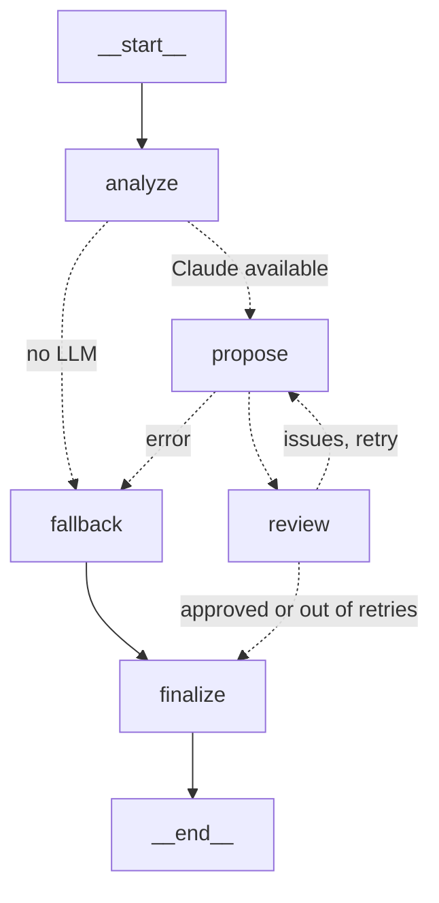

# Nemesis Protocol

**An arena shooter where the enemies learn from you.** After every wave, an *AI Director* built
with LangGraph and Claude analyzes how you play (which weapon you use, your accuracy, how much
damage you take) and evolves the enemies to counter your style. Rely on the pistol and they come
back armored. Fight with the sword and they learn to shoot you from a distance.

## How it works

```
 Game (Ursina)                    AI Director (LangGraph + Claude)              Game
┌──────────────────┐ WaveTelemetry ┌───────────────────────────────┐ Adaptation ┌──────────────────────────┐
│ Wave N           │ ────────────► │ analyze → propose → review    │ ─────────► │ apply_adaptation(        │
│ attacks, hits,   │               │             ▲          │      │            │   BASE_STATS, ...)       │
│ kills per weapon,│               │             └─ fix ◄───┘      │            │ + hard limits (clamps)   │
│ damage taken     │               │ on failure: local rules       │            │ → wave N+1 evolves       │
└──────────────────┘               └───────────────────────────────┘            └──────────────────────────┘
```

1. **Telemetry.** Every weapon reports its attacks, hits and kills. When a wave ends, the game
   builds a `WaveTelemetry` snapshot with accuracy, time per kill, usage share per weapon and the
   dominant weapon.
2. **A LangGraph decision.** The Director is a state graph. Claude proposes the evolution through
   LangChain structured output, and a deterministic reviewer validates it before it is accepted.
   It runs on a background thread, so the game never freezes. While it waits, the HUD shows
   *"The Director is analyzing your play style..."*.
3. **Review and self-correction.** If a proposal has an out-of-range value or does not counter the
   dominant weapon, the reviewer sends the concrete problems back to Claude and asks for a fixed
   version. In one real run, Claude proposed `armor +5` on a stat that ranges from 0 to 0.5.
4. **Safety.** The model's answer never touches the stats directly. It becomes a validated
   `Adaptation` that is always applied to the base stats (adaptations never stack), with hard
   per-stat limits.
5. **Fallback.** With no API key, no network, or any error, deterministic rules pick the
   counter-evolution. The game is always playable.
6. **Visible on screen.** Enemies change color with their strongest resistance, grow armor plates,
   carry an arm cannon when they attack from range, and get glowing stripes when they are fast.
   A panel explains the evolution, lists every stat that changed, and shows whether the reviewer
   asked for a correction.

### The Director graph



| Node | What it does |
|---|---|
| `analyze` | Builds the player profile (specialist or generalist, performance) and the rule-based suggestion. |
| `propose` | Claude, through `ChatAnthropic.with_structured_output`, designs the evolution from the telemetry, the profile, the history and the suggestion. |
| `review` | Checks limits, the number of changes, and that the evolution targets the dominant weapon. If anything fails, it loops back to `propose` with the issues. |
| `fallback` | Uses the rule-based suggestion when Claude is unavailable or fails. |
| `finalize` | Applies the adaptation to the base stats, within the limits. |

With LangSmith configured in `.env`, every decision is traced as a `director-wave-N` run that
holds the telemetry, the prompt, Claude's answer and the review.

## Example counter-evolutions

| If you dominate with... | The enemies... |
|---|---|
| Sword (slash, melee) | resist slashes and shoot you before you reach them |
| Hammer (slow and heavy) | resist blunt hits, move faster and attack more often |
| Pistol (medium range) | gain armor and pierce resistance, and close the distance |
| Shotgun (short range) | keep their distance and attack from beyond its reach |
| Bow (long range) | become smaller, very fast, and spot you from anywhere |

On top of that, enemy health scales with every wave, and they hit harder if you finished the
last wave almost untouched.

## Running it

Requires Python 3.12 and [uv](https://docs.astral.sh/uv/).

```
uv sync
uv run main.py
```

To use Claude as the Director, copy `.env.example` to `.env` and set your `ANTHROPIC_API_KEY`.
Without a key, the game uses the local rules. The top-left panel shows which Director is active.
To trace decisions in LangSmith, also fill in the `LANGSMITH_*` variables.

**Controls:** WASD to move, mouse to aim, left click to attack, keys 1 to 5 to switch weapons
(Sword, Pistol, Hammer, Shotgun, Bow).

Every Director decision is saved to `telemetry/director_log.jsonl`, together with the telemetry
that triggered it.

### Language

The game ships in Spanish and English. The `LANGUAGE` variable in `.env` sets the language of the
HUD, the console logs and the Director's explanations, including the ones Claude writes.

```
LANGUAGE=es   # Spanish (default)
LANGUAGE=en   # English
```

All texts live in `shared/i18n.py`. Telemetry uses language-neutral weapon ids (`pistol`,
`sword`...), so switching languages never changes the data or the decisions.

## Tests

```
uv run pytest
```

They cover the damage formula, the adaptation rules and limits, the telemetry contract, the
player action tracker, both languages, and every path of the Director graph. The graph tests use
a fake model with scripted answers, so they run offline and spend no tokens.

## Tech stack

- **Python 3.12** with **uv** for environments and dependencies.
- **Ursina** (a 3D engine on top of Panda3D) for the game.
- **LangGraph** for the Director workflow, with a review loop and conditional routing.
- **LangChain** (`langchain-anthropic`) with **Claude** structured outputs.
- **LangSmith** for tracing every decision.
- **Pydantic** for the frozen, validated contracts between the game and the Director.
- **pytest** for the test suite.

## About this project

Nemesis Protocol is a hobby project, built to learn and to show how an LLM can sit inside a
real-time system without being trusted blindly. The interesting part is not the call to the
model, but everything around it: typed contracts, validation and retries, hard limits,
a deterministic fallback, non-blocking execution in the game loop, observability, and tests
that exercise the AI paths without a network.
